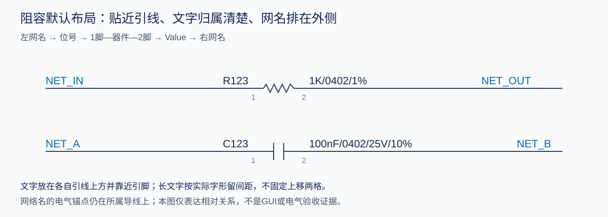
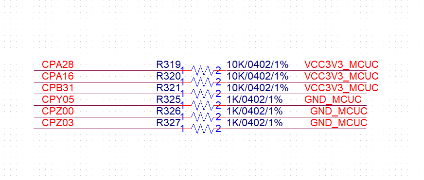
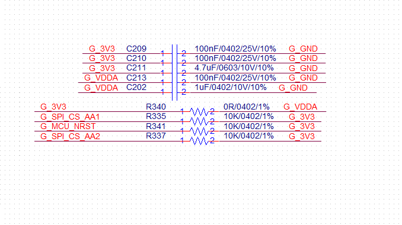

# Capture 阻容本机库、文字方向与引脚线对齐规范

现行版本：**RC-20261117.1**。本文件是本用户阻容排版的唯一现行规范；[机器规则](capture_rc_layout_contract.json)与之配套。2026-11-16纠正优先于旧的“一律横放”“字向按空间自由选择”“只需落网格/不重叠”等表述。其他方法只链接本规范，不另定一套阻容方向规则。

> **紧凑度另须 AND 验收 [COMPACT-20261116.1](capture_schematic_compactness_standard.md)及[机器 contract](capture_schematic_compactness_contract.json)**。RC五项名称保持不变；2026-11-17已扩充RCALIGN实际字形贴线验收；旧 RC 检查器不覆盖功能组行距及器件至端符线长。只有不碰撞、落网格或长直线没有折弯，不能据此称排版完成。

## 最高优先纠正：竖排实际字形必须紧挨引脚线（2026-11-17）

用户指定DP_C5为水平正例、DP_C8为竖排离线过远反例。先读[完整纠正与可复用判断](capture_rc_vertical_proximity_20261117.md)。横/竖字向、落网格、锚点在线仍不够；Ref和完整Value的实际字形须分别紧挨自己的引脚线且不干涉。竖件核左右间距，横件核上下间距；不能机械沿用固定+10偏移，不能从截图像素猜CAD偏移。

RCALIGN现在还须绑定原生旋转文字框架、完整字形到所属引线的垂直间距及批准正例上限。上限从实际原生正例/当前字体网格量化获得，最多额外一格；缺这组证据为UNKNOWN。先以一个横件和一个竖件复核，再覆盖全部竖置阻容；水平“基本OK”不等于全量已签核。

## 用户指定的正式符号（2026-11-16追加，属于规格）

| 器件类别 | 本机正式原理图库 | 指定符号 |
| --- | --- | --- |
| 电阻 | D:/005lib/01captureLib/000Resistor.OLB | R |
| 普通非极性电容 | D:/005lib/01captureLib/002Capacitor.OLB | C |
| 电解、钽电容 | D:/005lib/01captureLib/002Capacitor.OLB | C_ELEC |

2026-11-16已原生回读确认实际名称为大写R、C、C_ELEC，均有物理1/2脚。这是指定来源，不能以COMMON_PC、其他本机同形符号或新派生符号代替。先核类别、实际物料和极性；不因符号替换交换现有电气脚号。库文件可由用户继续更新，每次操作固定并上传/读回当次SHA；不能把某一次SHA永久写死而拒绝用户新版本。

## 五项必须逐器件执行的要求

1. **RCLIB：全部阻容采用本机正式公共库。** 原理图从本机 `01captureLib` 的现有正式OLB复用，PCB及焊盘从本机 `01Psm_lib`、`01Pad_lib` 复用。当前根为D:/005lib。先同步并固定库版本，再设计。记录每个实例的库文件、SHA、包/视图、实际脚号；核Design Cache的本体/针线/针距/物理脚映射与正式库一致。仅把libName写成本机路径不构成复用证明；不得擅自复制放大、改针距或重画阻容，再把派生符号放进公共目录冒充符合要求。网格或空间不合适时先调整实例姿态、局部导线及留白；确实缺少可用型号/符号时明确列未解决项，不自行豁免。
2. **RCAXIS：横件横字，竖件竖字。** 按保存重开后真实物理引脚轴向判断器件方向，不能只看实例rotation。横置阻容的位号和完整Value均水平；竖置阻容的位号和完整Value均竖直（随器件方向旋转90°/270°）。不得只旋转Value而保留水平位号，也不得以方便阅读或避让为由混用字向。实际脚号、极性及Kelvin关系不交换。
3. **RCALIGN：位号和Value沿各自引脚线齐平。** 横置样式为位号在左侧引线区域、Value在右侧引线区域；采用竖置时将这一关系随器件整体旋转，两项文字分别沿旋转后的两端引线排列，同方向、归属清楚。按原生文字基准和用户认可样例校准，文字与引脚线齐平并贴近所属引线；不能任意放在本体左右或上方空位，更不能移动到邻件旁。这里“在网线上”不等于将文字墨迹压在电气导线上；文字与线、本体仍须无干涉。长Value需要延长本器件所属短引线或增加局部留白，不能靠离开基准线、换字向、截断或无限缩字解决。
4. **RCGRID：电气及显示锚点落工程网格。** 读取PinToPin、实际单位和用户半针距要求，再核实例、实际针热点、导线、端口、Alias及Ref/Value锚点。落网格与沿引脚线对齐是两个独立条件。不能把某工程5文档单位当所有工程默认；不能逐点盲目取整改变连接。Alias电气锚点始终在自己的真实导线上。
5. **RCCLEAR：完整文字和完整场景无干涉。** Ref、实际显示Value/User_Value、针名针号、器件本体/针线、网名、导线、端口、连接点和表格一起检查。两项文字保持本器件归属及相同阅读方向。碰撞为零不能替代前四项；网表相同不能替代任何排版检查。

## 灵活运用的边界

可以根据电路功能、阅读顺序和参考拓扑选择器件横放、竖放或混合，调整模块留白、支路和局部短引线；同一电源页中不同支路可以选不同方向。**确定某只阻容的方向后，该器件的Ref/Value方向、引脚线对齐、本机库、网格及避让要求必须满足。** 不以“灵活”为上述要求开例外。

先保留可读原理与用户清晰参考，按新需求局部融合。反馈、补偿、分压、去耦不拆成孤立网名表；MOS/BJT仍用真实内部图形，电源/翻页仍按所属导线末段自然平接。物料和电气变化另按授权处理。

## 用户参考的读取方法

2026-11-10已记录用户认可的R332/R333：CORE_R零旋转、无镜像，实际针热点(-10,10)/(30,10)，位号局部(-45,0)、Value(35,0)，Arial 9。该关系说明文字沿两端引线齐平、字形不压线；DisplayProp的TOP锚点不等于文字基线，不能强令所有locY等于导线y。

这些是该符号、字体和实例的参考数据，换符号/字体/镜像要重读原生实际变换，不能硬套坐标。竖置将完整样式整体旋转，Ref和Value一起转；绝对DP偏移不一定随PartInst自动旋转。缺少同版本校准时标未验，不能靠猜固定偏移发布。

## 2026-11-11 用户确认的同行示例与排版验收

该图用于理解两端归属、引线基准、完整文字及网名外置。它是横置示例，不要求所有功能支路横放，也不授权竖置时保留横字。截图中的物料与电气不能直接当新工程输入。

## 2026-11-11 新增：阻容按功能分组，紧凑成行、整齐成列（所有页码）

全页码先按功能组织，保留连续电路与原引脚身份。同组在适合其方向的局部坐标系中对齐、紧凑排列，组间留白；不同模块不必共用绝对坐标。不得为成表搬散反馈/去耦关系或新增长U形回折。

按 [COMPACT-20261116.1](capture_schematic_compactness_standard.md)记录当前网格、完整字形包络、实际组内行距及连续引线路径，并对照有独立邻域/原理证据的合理候选预算。允许同功能组按最长必要文字和真实热点形成共同短列，保留少量网格余量；不得按全页宽度拉长所有引线，或等分页面高度把少量器件摊开。追求适当短、清楚成组，不为机械最短牺牲完整文字、字向、归属或连续电路。

## 开始前与交付前的执行办法

开始前读取本文件与机器规则，输出本次规则版本、GitHub/本机库身份、处理的全部页码及“要求→操作→核验字段”对应表。先用一个本机横置阻容和一个竖置阻容验证整套文字/热点变换，再批量处理；既有批准小样只在库、字体与原生变换一致时复用。

每个R/C实例输出：页名/Ref、正式库身份及缓存一致结果、真实引脚轴向、Ref方向、Value方向、两项文字的引脚线对齐结果、网格结果、完整场景干涉结果。全部实例必须覆盖；未分类、未校准、未验证不能填PASS。使用[规则检查器](../scripts/capture_layout_tools/check_rc_layout_contract.py)核逐件事实和证据绑定，旧的只做避让的候选工具不能单独签核本规范。

另运行[紧凑度 facts 检查器](../scripts/capture_layout_tools/check_schematic_compactness.py)，覆盖本次全部功能组及器件至端符引线。RC 五项与 COMPACT 均须通过；预算、分组、邻域或当前网格证据缺失为 UNKNOWN，不能把旧 RC 五项通过冒称紧凑度通过。

保存、独立重开后重新检查，并逐Ref.Pin核网络分区、具名网络、NC、Value、装配与封装。GUI、离线模型、电气及PCB各自报告范围；后台要求继续遵守。任何必需项失败或未知时，保留候选及问题清单，不以“已全部合规/排版完成”回写正式源件。

同名库冲突先保护本机最新版本并分开审查，不盲目覆盖。通用规范、可复用工具在学习库；源件、专用脚本、原生日志、校准与审核在工程根。规则同步不代表已整改当前设计。
