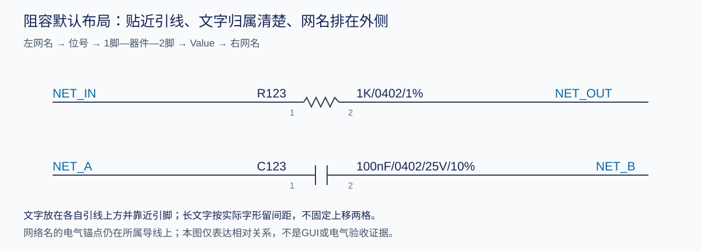
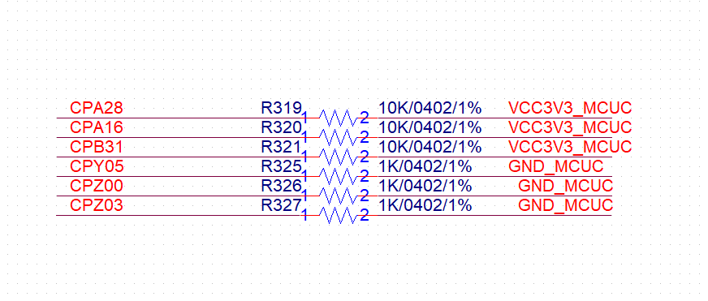

# Capture 阻容方向、位号与 Value 排版规范

> 统一入口：[清晰排版与简洁连接方案](capture_compact_schematic_layout_method.md)。2026-11-10 用户再次明确：**阻容横放，1 脚在左、2 脚在右；位号紧挨 1 脚侧导线上方，Value 紧挨 2 脚侧导线上方，网络名排在两者外侧。** 此要求细化并优先于旧版笼统的“位号左、Value 右”。

> 2026-11-11 后续补充（本用户明确要求，优先执行）：原本已经横放的阻容，即使实际 1 脚在右、2 脚在左，也保留原脚序与清晰连接；**不能只为把 1/2 脚换到左右位置而改线**。位号仍在左侧引线紧上方，完整 Value 在右侧引线紧上方。新建或确需竖转横时才默认 1 左、2 右；极性及电气身份始终保持。

## 布局要求

1. 新建及整理普通二端电阻、电容时，默认水平放置，实际 1 脚在左、2 脚在右。按符号物理脚号、原生热点和保存后的实际变换判断，不能只看 rotation 参数；极性器件不得交换脚号或极性。去耦电容也不因“到地”自动豁免为竖放；例外须有当前任务的明确依据并单列记录。
2. 标准 1 左/2 右布局时，**位号放在 1 脚左侧引线的紧上方**，靠近 1 脚，文字归属一目了然。以可见字形靠近引脚侧为准，不移到器件正上方居中，也不为了避让挪到远处。对齐方式可随库字形调整，不强制改变已有正确实例的左对齐设置。
3. 标准 1 左/2 右布局时，**Value 放在 2 脚右侧引线的紧上方**，靠近 2 脚，完整保留阻值/容值、封装、电压、精度及装配标识。位号与 Value 保持水平，尽量形成同一阅读行；上方间隙按实际字形确定，不固定上移两格。
4. 从左到右的阅读顺序是 **左网名 → 位号 → 1 脚—器件—2 脚 → Value → 右网名**。左网名的整个可见范围在位号外侧，右网名在 Value 外侧；不得把网名夹在器件和位号/Value 之间。先核完整字宽再确定间距，长网名和长 Value 不截断、不无限缩小。
5. 位号、Value、网名与可见脚号/脚名、器件、相邻导线及其他文字互相避让。不能只证明“互不重叠”就把本器件的文字放到邻近器件旁。紧凑行距同样按真实字形检查，不将本次两个参考器件的行距设成全工程固定值。
6. 先移动显示属性和对齐，再沿所属导线调整网名；确有需要时才协调局部短线。**NetAlias 的电气锚点必须留在原所属导线上**，不能为了让字形在导线上方而把 Alias 的 locY 抬离导线。DisplayProp 与 Alias 的锚点语义不同，同一视觉文字行不等于相同存储 locY。



示意只表达相对顺序和归属，不规定所有符号共用坐标、字号或网格：

```text
左网名          位号                   Value                 右网名
──────────────────1──[ R / C ]──2───────────────────────────────
```

## 用户参考的读取方法

2026-11-10 用户指定 `01SCH/04AIABrushlessV4_01_02_STM32_cores.DSN` 的 **R332、R333** 作为样式参照。官方 XML 读回的当前 `CORE_R` 为零旋转、无镜像，两个实际引脚热点分别为局部 `(-10,10)`、`(30,10)`；两器件的位号局部偏移均为 `(-45,0)`，Value 均为 `(35,0)`，字体为 Arial 9。位号/Value 的存储位置因此在引线 y=10 的上侧，左右网名锚点仍在自己的水平导线上。

这些数值仅是**该符号、该字体、该保存实例**的实测参考；换电容符号、字号、旋转或镜像时，重新读取实际 1/2 脚和字形范围，不能把 `(-45,0)/(35,0)` 无条件写成所有库的默认值。完整源快照、SHA256、官方 XML 和逐器件测量记录保留在对应工程根；学习库只提炼通用规范及通用示意图。本次记录规范并不代表已批量整理其他器件或整张原理图。

## 数据与库的边界

- 保留实际位号、阻容参数、封装、MPN、装配状态和 NC_ 空贴标识；Value 格式继续按 [阻容 Value 规范](rc_value_display_conventions.md)。本规范只改变显示和经过验证的连接几何。
- 原理图库默认显示与已有实例的显示覆盖分别处理。修改库模板不代表已有实例已更新；不能为排版批量换成引脚编号、极性或电气类型不同的符号。
- 工程网格由 pin-to-pin 与当前单位换算确定。用户常用 `1/2 of pin to pin`；某工程对应 5 文档单位，不代表其他库也可硬编码为 5。
- PCB 的摆放不跟随原理图显示旋转。排版前后网表等价时，PCB 可保持铜皮、布线、器件位置、约束和封装不变，并在新版本中核对网表一致性。

## 实施与验收

1. 固定最新保存的 DSN/BRD 副本、来源时间和 SHA256，避免覆盖用户正在编辑的文件。
2. 读取官方 XML 及同版本原生引脚、仿射坐标、显示属性与字体；先审计全工程方向、左右文字和冲突，再生成逐器件计划。见 [文字几何方法](capture_text_geometry_and_readability.md)。
3. 先调整有清晰空间的器件；涉及旋转或导线改动时，记录原始及目标热点、引脚身份、导线端点与所有受影响附件。拥挤、极性或未知锚点进入例外清单，不强行批量套用。
4. 导入前按本机官方 XSD 校验 XML，使用标准 UTF-8 声明；整数坐标输出整数文本（例如 `22`，不能写成 `22.0`）。再官方导入/保存，独立重新打开，导出新 XML、原生坐标和完整 PCB Editor 网表。比较全部 ref.pin 的连接分区、网络名、器件、封装及属性；任何非授权电气变化均不得发布为完成版。
5. 在最终读回版本重新检查实际显示字符串及字形碰撞，逐页预览重点复核密集区域。分别报告“离线几何已核”“Capture 实际画面已核”“电气等价已核”，不能互相替代。保留未解决项目、例外及数量。

通用规范和参数化工具放学习库；工程计划、前后截图、原生导出、专用脚本和校验记录放工程目录。仅建立本规范不能宣称现有工程已经完成排版。

## 2026-11-11 用户确认的同行示例与排版验收



这张图是本用户明确提供的排版参考。它规定相对关系、功能组织和阅读方式；图中的阻值、网名、字号及屏幕像素坐标不作为其他工程的物料或固定坐标输入。

- 同组独立信号按行排列：左网名 → 位号 → 1 脚—阻容本体—2 脚 → 完整 Value → 右网名。每行连接短直，网名在属性外侧，保持原电路的信号次序与功能分组。
- 位号的可见字形紧挨 1 脚侧引脚线的上边，Value 的可见字形紧挨 2 脚侧引脚线的上边；两者保持水平，尽量同一文字行。不是只放到本体左右，也不是本体上方居中。
- 按实际符号、字体和完整字符串确定字形底边到引线的小间隙。不得把某次保存的 locY、11 文档单位或“上移两格”直接变成所有器件的规则。真实物理 1/2 脚的身份与连接必须保持。
- 去耦电容沿用横放和两侧属性原则；连接以就近、简洁为准。电容、串联电阻、上下拉、Kelvin 四端采样等按各自的电路角色处理，不能为了同一个几何模板把它们统一搬到任意空白区。
- 已经横放、分组清楚且连线短直的器件，优先保留原位及原连接，只处理必要的符号和文字。竖转横优先核原热点与库针距，生成必要的局部调整；不能先挪走全部阻容，再用全页寻路把原端点追回去。

### 明确不合格的结果

因批量横放或腾出文字空间，新增长 U 形回折、跨功能块绕线、无关信号线束，或让连线穿过配置表、标题与说明区，均为排版不合格。位号、Value、网名、脚号彼此重叠或压线；完整 Value 被截断、缩到难读、挪到邻近器件旁，也不能通过。网表等价、PCB 几何保持和原生保存成功都不能消除这些排版问题。

### 交付前的独立验收

1. 在已保存、独立重开的最终候选上逐页检查；先看功能分组与信号阅读顺序，再看局部短直连接和完整文字避让。密集区必须核对实际器件、针线、可见脚名脚号、网名及表格；不能只检查位号/Value 两个坐标。
2. 布局预览须绑定同版 XML、真实库来源、原生仿射与字体。未画出引脚文字、漏掉端口/表格或套错库图形的简化预览，不能作为完整排版验收依据。
3. 电气等价、离线几何/排版、实际 GUI、PCB 导入分别记录状态及范围。电气通过不能写成排版通过；GUI 未验就写未验。存在上述可见缺陷或未覆盖的关键显示对象时，候选不能以“已完成排版”回写正式版本。
4. 用户要求后台时，使用原生 Tcl / Allegro 批处理及离线预览，不启动或激活前台窗口来补验收；后台无法覆盖的检查如实标注，不擅自抢占桌面。
5. 实际工程的源快照、脚本、临时文件、工作目录、运行日志、逐器件计划和验证结果放在用户指定的工程根目录下。工具接收工程根参数；需要重定向 TEMP/TMP 时只作用于本次子进程，不修改系统设置。学习库只保存通用规范和获准归档的参考示例。

本次更正源于实际失败：只满足横放和网表一致，却产生大量回折、交叉、穿表和文字挤压。后续任务应优先保留清晰电路组织，并把排版验收作为独立的完成条件。

## 已横放器件的保留与最小调整

先调整实际 DisplayProp 偏移、对齐和网名显示，保持文字紧挨各自侧引线的上边。仅在确有完整文字/图形冲突、竖转横或脚距适配需要时做必要的局部调整；原因应写入计划，不能把“1 脚原本在右”列为改线理由。网名显示与电气热点分别核对，移动显示不应误移连接。

本机库与原图针距不同时，先核保留原热点的工程内派生方案，并记录原库来源；必须用原生保存和读回证明真实脚号、针距、连线与属性正确。不能只修改实例引脚覆盖就假定已生效，不能把普通二端布局套到四端采样器件。四端器件的电流端与采样端关系按原设计逐脚保留。
