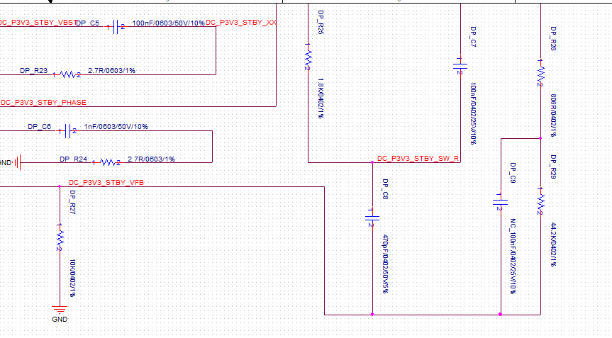

# 竖置阻容：实际字形必须贴近所属引脚线

2026-11-17用户纠正，属于RCALIGN的必需内容，现行RC-20261117.1。不是另加一种可选字向。

用户明确指出：Z690I_SIONPC_CARDV1_01_00中的DP_C5水平样式OK，DP_C8竖排位号和Value离引脚线太远。水平“基本OK”不等于全部水平实例已验收。

## 本次必须学会和复用的判断

1. 方向、网格、存储锚点对齐、实际字形贴近，是不同条件。竖件两项字都竖、也落网格，仍可能因旋转文字框架/字体原点处理错误而离引脚线太远。不能再用前三项代替第四项。
2. 保持位号和完整Value沿本器件两端引线、同向且归属清楚；分别测完整字形到自己引脚线的垂直距离。竖件检查左右间距，横件检查上下间距。沿线方向的起止位置另核，不能只量文字到器件中心的直线距离。
3. 按用户认可的DP_C5水平样式固定实际DSN/原生导出、库/字体身份及完整字形间距，再在当前库的真实原生旋转文字框架中校准竖件。截图用于确认正反例，**不得从截图像素猜文档单位偏移**；不得把水平Y=-10机械换成竖排X=+10后直接签核。
4. 合理的贴线间距上限来自批准的原生正例及当前网格量化，额外余量最多一格，不是任意宽容差。位号、Value各自比较；文字不能压线、压针号或本体，也不能因长Value而向侧面漂移。
5. 先核一横一竖，再覆盖四套图的全部竖置R/C并重新运行规则。已有正确水平实例不为迁就竖排而整批改动。保留反馈、补偿、分压和去耦的连续原理关系；不拆成孤立网名表。
6. 每件需记录：原生真实引脚轴、两项字向、字形框架、自己的引线段、实际垂直间距、批准正例及其上限、完整邻域无干涉证据。仅有相同锚点偏移、相同rotation、GUI中大概接近或网表通过均不够。缺证据为UNKNOWN。

## 防止再次漏执行的机器门禁

RCALIGN现在同时检查原生基准线与`alignment.proximity`证据：实际完整字形bounds、所属引线、批准正例身份、原生旋转文字框架、当前网格及最大间距。旧的只证明anchor在线/落网格的事实不能继续返回RCALIGN=PASS。RC五项和COMPACT仍须独立全部通过。

若`IsBoundingBoxDirty`为真或原生框是(0,0,0,0)，不得把它当成实际文字范围。当前Capture实读已出现这种情况；需用有效的原生渲染校准和完整LOGFONT字形数据，不能用零框清除问题。

## 可复用的原生后台读取办法

单独tclsh加载DLL后GetDesignAndSchematics崩溃，不代表Capture自身脚本入口也不可用。已在本机初始化完成的Capture Tcl宿主中验证同一只读小样可以读取GetOffsetGraphicPoint三个基点、实际针热点、DisplayProp位置/字向和完整字体，且不保存设计。入口使用安装文档`cap_ug/Execute_TCL_script_in_Windows.html`的`Capture.exe <script.tcl>`；启动脚本只写一行`source {完整正文脚本}`，把多行proc/控制流程放正文，避免命令文件运行方式误解多行块。

安全边界：只开冻结的自有副本，核源SHA和输出绑定；复用已初始化宿主，不再次装载DLL或替换用户会话；不改Startup/安全设置，不发送Windows输入，不保存用户现场。Dbo getters正确签名包括`GetDefaultFontType(state)`、`GetFont(fontType, LOGFONT)`、`GetHorizontalTextJustification()`；字体名用`DboTclHelper_sGetLFName(LOGFONT, CString)`。缓存可见性getter是`GetPinNamesAreVisible`/`GetPinNumbersAreVisible`。实际命令/参数须按当前安装验证，不把历史路径当常量。

原生数据、原生渲染、GUI像素、电气和PCB分别报告。后台脚本成功不等于全页排版完成。
