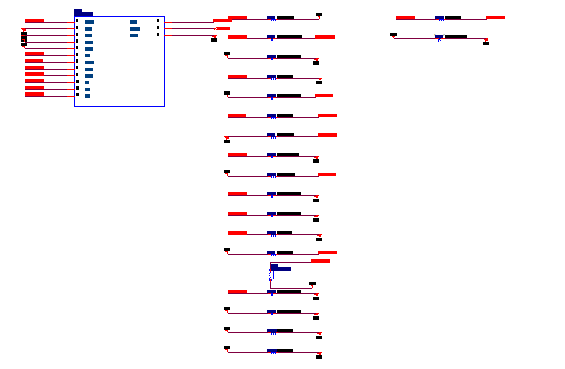
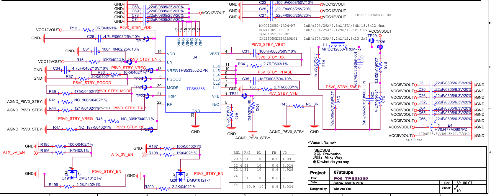
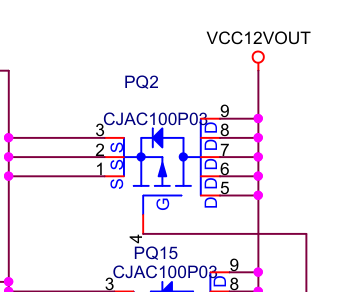
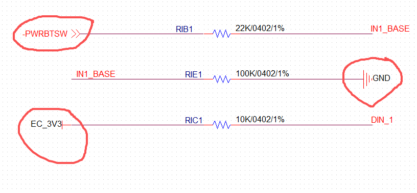
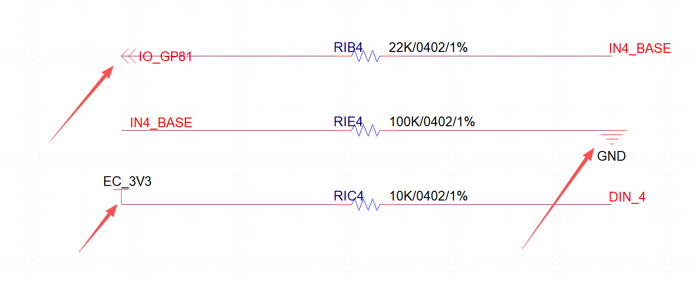

# 原理图按电路原理融合：参考模块、文字、网格、MOS与端部连接符

2026-11-15用户明确修正规则。适用于本用户的新建与整理原理图，优先于旧笔记中“阻容一律横放”等冲突表述。具体原图参数只属于各自工程，不能把排版示例的物料、引脚定义或电气修改套到其他工程。

## 可复用的灵活判断方法

**本轮主要目的：把“根据上下文作设计取舍”的方法保存成后续可以读取、执行、核验的知识，并同步本机学习库和GitHub。可复用的核心是判断过程及原则，具体摆法、绝对坐标和整齐表格只是某一次选择的结果。**

每次设计先回答以下问题，选择适合当前模块的表达：

1. **读什么电路？** 识别输入、输出、供电/地、主电流或信号路径、控制、反馈及保护。先画清这些关系，再安排器件；读者应能顺着图理解工作过程。
2. **参考为什么清楚？** 找出原图让人易读的直接连线、邻接、上下支路和局部分组；保留有效部分，局部融合新需求。参考中已经变更的电气、旧物料和不合适细节分别判断，不整体机械照搬。
3. **哪种方向/端部表达更合适？** 比较横放、竖放或混合后，反馈是否直观、信号是否顺畅、线是否短而少交叉、文字是否靠近所属器件且不干涉。完整DC/DC的支路与独立串联电阻行可采用不同方向；选择理由来自此处电路，而非“上次这么画”。
4. **冲突时调整哪一级？** 先调文字/连接符的局部偏移，再调支路留白和相邻器件，确有需要才重排模块。保持电气身份和功能连续性，不为对齐把电路拆成网名小岛。网格、作用域、脚号及完整文字是持续检查项。
5. **改后是否更容易读？** 逐模块沿真实电路阅读，并检查全页密集区；电气等价与可读性各自验收。若读起来更难，返回前一步重新选择方向或结构，不能只因网表通过就接受。

后续执行记录写清“此处器件角色→选择→取舍理由→验证结果”，不必为每只普通器件重复长篇说明；相同电路模式可以复用判断，情境变化时重新评估。学习库中的正反例用于训练这种选择过程，不要求所有工程复制同一结果。本机方法、技能入口和GitHub版本应同步，并记录远端读回身份，便于后续继续复用。

## 先保留可读的原理，再融合新需求

用户提供、已经优化过的原理图可直接作为功能模块布局模板。复用应包含器件相对位置和横竖方向、引脚分组、直接导线、T分支、反馈/补偿/分压、去耦及启停关系；同时保存来源、预期电气及变化白名单。不是只提取BOM再把每只阻容放到独立网名行。

直观阅读顺序以电路角色为准：电源输入→转换器/开关→电感/输出；反馈从输出回到FB，分压/补偿就近成支路；信号输入→限流/滤波→MOS或三极管→输出/采样。只有确有远程追踪、跨页或模块边界需要时才用网名/翻页连接。即使网表一致，把局部简单电路拆成很多孤立网名小岛也属于可读性失败。

修改时先匹配参考与目标的Ref.Pin、功能和网络，再保留未变部分、局部融合已改启停/PG或物料；不恢复已删除元件、不照抄旧电气错误、不将截图中的阻值当新设计输入。没有清晰参考时仍先组织功能块，再做文字微调。

## “灵活运用”必须落实为电路判断

用户2026-11-15进一步明确：不能把示例变成机械排版算法。先判断器件在模块内的作用和电流/信号路径，再选择方向和文字位置；参考图展示的是解决特定问题的好布局，不是所有元件必须照同一方向。

- 画完整DC/DC模块时，去耦到地、输出电容、分压和反馈/补偿支路常需要竖着摆放，以呈现上下电位和主功率路径；输入/输出及串联支路仍可水平。不要把这些支路拆成一排孤立的网名电阻。
- 类似用户刚给出的独立串联信号、接口电阻行，横着放便于从左到右阅读，位号与完整Value左右排列；它们也不意味着整页电容都要横放。
- 字向同样需要判断：用户给出的完整DC/DC图中，部分竖直反馈支路沿用旋转Value来避开邻线；独立电阻行的文字通常水平。保留位号左、Value右的器件归属，按真实字形和支路空间选择，不把“文字一律水平”再变成硬模板。
- 同一模块可混合横竖；已有清楚的参考优先保留。电气关系、器件归属、可读性优先于“统一朝向”和绝对坐标，对齐/紧凑用于辅助阅读。
- “灵活”不放松不干涉、网格与电气一致要求。应在计划中说明这一功能块为什么采用此方向/连接方式；遇到冲突先增加局部留白或调整短支路，不能用该词掩盖漏验或随意摆放。

## 阻容横竖方向与左右文字

- **横放和竖放均允许**，优先保留参考电路的方向与拓扑，不为统一方向把电路拆散。实际脚号、极性、Kelvin/四端关系保持。
- 横放：位号在本体左侧引线附近，完整Value在右侧，文字锚点落工程网格，基线/近线关系参照用户图；文字不碰本体、针号、网名、邻线及其他文字。
- 竖放：位号在本体左侧、完整Value在右侧，字向结合清晰参考和空间选择，显示锚点落网格；按真实字形避让竖直引线和分支。不能仅因实例旋转就机械转文字；参考中的旋转Value可沿支路保留，仍须清晰对应本器件，不能放到远处。
- 同功能组紧凑对齐，但分压、电源去耦、补偿/反馈、栅极支路等以原理关系为先。文字位置找不到空间时调整局部支路或模块留白，不截断、不无限缩小、不把Value挤到隔壁器件。
- “落在网格线上”针对实例/文字锚点和电气热点；字形边缘无需生硬取整到网格。DisplayProp和Alias的锚点语义不同，Alias必须仍在自己的真实导线上。

## 网格是电气与显示的共同约束

读取当前PinToPin、工程单位、捕捉设置及库符号针距。本用户既定参考为 **1/2 of pin to pin**，在PinToPin=10文档单位的工程对应5文档单位；换工程重新换算，不能把5或mm当通用值。捕捉设置、实例原点、可连接引脚热点、导线端点、连接符热点、位号/Value锚点分别检查。

库针距18或24文档单位与5文档单位网格不兼容，不能只把实例原点取整后宣称已对齐。需要修符号针距时保留物理脚号与名称，连同相关导线/端口重建或整体变换。已有清晰原图的合法相对锚点优先保护；不逐对象盲目四舍五入。保存重开后重新量取，逐物理脚验证连接不变。原生可读接口不足时明确区分“已验证对象坐标”与“未改应用级捕捉偏好”。

## MOS等离散器件须能看出电气结构

使用正确的MOS沟道、栅极、源漏与体二极管/内部连接图形；区分N/P、单管/双管、共源/共漏、多脚并联、独立EP。不能只用普通矩形和G/S/D文字冒充，也不要求IC内部展开。BJT保留基极、集电极、发射极及箭头；极性器件保留其结构标识。优先复用本机真实符号，改图形前核Ref.Pin、实际封装与厂家定义，不能只按名字猜。

## 电源与翻页符按导线末段自然平接

用户红圈为正确、箭头所指为错误；不是把这句话理解成“所有箭头图形一律错误”。水平导线左端应读作 **网名 >> —— 电路**，右端对应 **电路 —— << 网名**；翻页符可见尖头朝向所属电路，完整名称位于外侧空白，不叠在承载线或器件文字上。该放置方向不代替真实输入/输出/双向电气类型。

水平导线端部的电源、GND按连接方向旋转并平接，电源/地名在外侧，保持水平；不要为了使用默认向上的电源或向下的地符号，在本来直线端部额外加一格竖直折线。真正竖直支路可以顺其末段接向上电源/向下地，不强行改为水平电路。GND符号、电源图形、翻页轮廓、网名与文字不得互压。

电源仍用真实Global及正确作用域，跨页信号仍用真实可见OffPageConnector，两端齐备；普通页内网络仍用WireScalar/Alias。不用注释、悬空网名、空白符号或透明端口制造相似外观。旋转/移动必须计算符号真实热点及Name显示偏移，不能只转文字或凭locX/locY猜连接。一次合格的图形修改必须同时通过热点在线、网表不变及完整显示检查。

## 实施验收

1. 固定最新DSN/PCB、参考图及库的身份；计划先列功能模块、逐页范围、可移动与不可变部分。
2. 先按上述规则保留/恢复电路组织，后调文字和端部对象。真实元件图形、完整针名针号、端口、电源、Alias、导线、文字及表格全部进入显示检查。
3. 原生导入保存、独立重开；对全部Ref.Pin、NC、Value、装配标识、封装和关键属性比较，不只数网络。不因原理图旋转而同步旋转PCB器件。
4. 逐页离线图和密集区检查；源图复用也要检查修订后的文字/端口碰撞。GUI、离线几何、电气、PCB各自记录，后台不激活窗口。任一已知可见问题未解决时不得称全页排版完成。
5. 通用规则/示例保存本机学习库并同步已授权GitHub仓库，记录服务器读回SHA；真实项目源件、脚本、日志、审核记录在项目根。保存方法不等于自动加载或模型训练。
